# 计及GPU动态调频与液冷热惯性的AI算力园区算—电—热协同分布鲁棒容量规划

**Distributionally Robust Capacity Planning of AI Computing Parks with Computing–Power–Thermal Coordination Considering GPU Dynamic Frequency Scaling and Liquid-Cooling Thermal Inertia**

## 摘要

AI算力园区中，GPU的工作频率决定算力与发热，液冷环路温度决定芯片能否安全运行、自然冷却能否使用以及余热品位，二者共同影响冷源、蓄冷与余热设备的配置；以固定单位算力功耗和固定冷却效率为依据的规划难以反映这种耦合。为此，提出一种计及GPU动态调频与液冷热惯性的AI算力园区算—电—热协同分布鲁棒容量规划方法。首先，建立多档调频下的GPU算力—功耗模型，计入温度相关漏电，以液冷环路热状态为纽带构建芯片热安全对频率档位的温区门控、气象相关的自然冷却与冷机能效、蓄冷与源温相关的余热热泵模型。其次，以光伏出力、算力负荷、环境温度与热负荷的联合日轨迹构造1-范数与∞-范数综合约束的模糊集，计入阶梯碳交易与售热收益，建立两阶段分布鲁棒容量规划模型，经温区分解精确线性化后采用列与约束生成算法求解。宁夏中卫算例表明：与传统规划相比，所提方法使能源侧年化成本降低14.4%、碳排放降低26.2%，年回收余热12.57 GWh；忽略芯片热安全约束的规划方案全年超温，并在高温日出现算力缺额；频率档位与液冷温度协同可取消机械制冷；在含极端日的样本外测试中，所提方法的期望年化总成本比随机规划和鲁棒优化分别低0.27%和3.9%。

**关键词**：AI算力园区；GPU动态调频；液冷热惯性；余热回收；分布鲁棒优化；容量规划

## 0 引言

人工智能大模型的训练与推理使数据中心用电快速增长。国际能源署估计，2024年全球数据中心用电约415 TWh，按基准情景2030年将增至约945 TWh，其中面向人工智能的算力设施是主要增量来源[1]。与传统数据中心相比，AI算力园区以高功率密度GPU集群为主，普遍采用液冷，单机柜功率可达数十千瓦。GPU的工作频率决定了算力与功耗，液冷环路温度决定了芯片能否安全运行、冷却系统能否利用自然冷源以及余热能否被回收。算力调度、IT功耗、冷却能耗与园区能源设备由此形成双向耦合：能源侧的冷源与蓄冷容量限制了GPU可运行的频率档位，GPU的频率选择又改变了冷负荷与余热品位。在这种耦合下，若仍以固定单位算力功耗和固定冷却效率确定园区能源设备容量，规划结果可能偏离实际运行需要。

**（1）数据中心作为电力系统灵活性资源。** 已有研究较早指出，数据中心可通过任务延期、负载迁移与功率调节参与需求响应[2]。近年的研究在更大时空尺度上量化了这种灵活性：Riepin等在地理分布的数据中心网络中同时考虑任务的时间推移与空间迁移，表明可调算力负荷比例每提高1个百分点，24/7无碳电力匹配成本约下降1.29 €/MWh[3]；Colangelo等在商用云数据中心的256卡GPU集群上进行了现场试验，通过软件调度AI任务（含GPU频率调节）在电网高峰时段使集群功率下降25%并持续3 h，同时满足服务质量要求[4]。这些研究证明了GPU频率与算力调度可以作为功率调节手段，但关注点在运行阶段的电网支撑，没有讨论这种调节能力对园区能源设备配置的影响。

**（2）数据中心综合能源系统的调度与规划。** Guo等综述了数据中心与智能电网的综合能源系统，指出配置可再生能源与储能后，数据中心兼具用能与供能双重属性[15]。在园区层面，Wang等建立了基于算力负荷转移的数据中心综合能源系统协同调度模型，表明转移计算任务可以同时转移电负荷与冷负荷[5]；Li等针对含数据中心的区域电—热综合能源系统，在风电不确定性下建立了分布鲁棒机会约束规划模型[6]；Ma等将实时任务响应纳入含数据中心的多能微网多阶段分布鲁棒低碳规划[7]。这类研究把数据中心纳入了能源系统规划框架，但数据中心通常被描述为“算力负荷 × 单位功耗系数”的电负荷，冷负荷由IT功率按固定能效比换算。在这种描述下，GPU频率、芯片温度与冷却系统之间的反向约束无法进入模型：既不能反映降频对功耗和发热的非线性影响，也不能反映液冷温度对漏电功耗、自然冷却能力和余热品位的同时作用。

**（3）IT侧的能耗与热管理。** 在计算机系统领域，GPU动态调频（DVFS）的节能效果已有大量实测。Tang等测量了多种GPU在不同频率下训练与推理深度学习模型的能耗，发现默认频率通常不是能效最优点，选择合适的核心频率可在训练中节能8.7%–23.1%[8]。芯片温度会影响漏电功耗，Zapater等在企业级服务器上建立了计及漏电的功耗模型，表明冷却控制若忽略温度—漏电关系会损失可观的节能空间[9]；Pakbaznia与Pedram将服务器功耗与冷却功耗合并优化，通过任务整合与送风温度选择降低了数据中心总能耗[10]。这些工作刻画了频率—功耗—温度之间的关系，但研究对象是单台服务器或单个机房的运行控制，冷却设备容量是给定的，也不涉及电价、可再生能源和余热利用。

**（4）液冷数据中心的余热回收。** 液冷提高了排热温度，使余热可以直接或经热泵用于建筑供暖。Zimmermann等的Aquasar原型以约60 ℃的热水冷却芯片，取消了冷机并将余热用于建筑供暖[11]；Luo等提出了数据中心余热回收的决策支持方法，在一个中型商业数据中心中可回收约68%的IT余热[12]。Ravi等把数据中心建模为向城市供热的产消者，表明灵活的计算负荷与区域供热结合可使数据中心对波动性可再生能源的消纳能力最多提高28%[16]。这些研究说明提高冷却温度有利于余热利用，但也意味着芯片热安全裕度减小、漏电功耗增加，高温运行还要求GPU降频。余热回收量、液冷运行温度与GPU频率档位三者之间的权衡，需要在计及芯片热安全约束的统一模型中确定，现有研究多在给定运行温度下评估回收潜力。

**（5）规划中的不确定性处理。** 园区规划需要同时面对光伏出力、算力负荷、环境温度与热负荷的不确定性。随机规划依赖准确的概率分布，鲁棒优化按最恶劣场景决策，结果偏保守。数据驱动的分布鲁棒优化以历史数据构造概率分布的模糊集，在两者之间取得折中；Zhao与Guan基于历史数据构造概率分布置信集，证明随数据量增加模型的保守性逐渐消失[13]，此类方法已用于含数据中心的综合能源系统规划[6-7]。两阶段鲁棒与分布鲁棒模型通常采用列与约束生成（C&CG）算法求解[14]。现有含数据中心的规划研究主要考虑可再生能源与负荷不确定性，环境温度一般作为确定参数；而在液冷与自然冷却系统中，环境温度直接决定自然冷却能力与冷机效率，并通过芯片热安全约束影响可用算力，是冷源规划中不可忽略的不确定因素。

**研究不足与本文工作。** 归纳上述研究，现有工作在AI算力园区规划上存在以下不足：

1. 能源系统规划研究[5-7]把数据中心描述为固定能效的电负荷，缺少GPU频率档位、芯片热安全与冷却温度之间的约束关系，无法评估调频与温度管理对冷源、蓄冷与储能容量的影响；
2. IT侧能耗与热管理研究[8-10]刻画了频率—功耗—温度关系，但停留在运行控制层面，设备容量给定，没有与电价、光伏、蓄冷和余热回收联合优化；
3. 余热回收研究[11-12,16]多在给定运行温度下评估回收潜力，未把液冷温度作为由芯片热安全、冷却成本与供热收益共同决定的优化变量；
4. 含数据中心的分布鲁棒规划[6-7]未将环境温度不确定性纳入模糊集，而环境温度通过冷却效率与热安全约束直接影响冷源配置。

针对上述不足，本文提出计及GPU动态调频与液冷热惯性的AI算力园区算—电—热协同分布鲁棒容量规划方法。主要工作如下：

1. 建立多档动态调频下的GPU算力—功耗模型，计入随液冷温度变化的漏电功耗；以液冷环路等效热状态为纽带，建立芯片热安全对频率档位的温区门控约束、气象依赖的自然冷却与冷机能效模型、蓄冷模型和源温依赖的余热热泵模型，形成“频率—功耗—温度—冷却—余热”闭环（对应不足1–3）；
2. 以光伏出力、算力负荷、环境温度与热负荷的联合日轨迹构造1-范数与∞-范数综合约束模糊集，计入阶梯碳交易与售热收益，建立两阶段分布鲁棒容量规划模型（对应不足4）；
3. 采用温区分解将温度相关参数精确线性化，以GPU数量与能源设备容量分步求解的两步法结合C&CG算法求解，并以等价单层混合整数线性规划校验；
4. 以宁夏中卫规划算力园区为算例，分析调频、热耦合、蓄冷与余热回收各自的作用，比较随机规划、鲁棒优化与分布鲁棒优化在含极端日的样本外测试中的表现，并分析置信水平、样本量、算力冗余率、芯片温度上限、热价与气候区的影响。

## 1 系统结构与规划框架

### 1.1 系统结构

AI算力园区综合能源系统由三层组成，见图1。

- 算力层：GPU计算集群，承担实时推理任务与可延期训练/批处理任务。
- 热管理层：冷板式液冷环路、干冷器自然冷却、电制冷机组、蓄冷水罐、余热回收热泵。
- 能源层：光伏、电池储能，以及与上级电网的购电接口。园区按防逆流方式并网，不向电网反送电。

GPU电功率转化的热量按比例β进入液冷环路，由自然冷却、机械制冷和余热热泵移出。蓄冷罐在冷源与环路之间时移冷量。热泵回收的热量供给园区及周边热用户，并按热价结算。

> **图1 AI算力园区算-电-热协同系统结构**　Fig.1 Structure of the computing–power–thermal coordinated AI computing park

### 1.2 规划框架与时间尺度

第一阶段（规划层）在不确定性实现前确定设备容量 x = (N, K\_PV, P\_B, E\_B, K\_FC, K\_MC, E\_TES, K\_HP)。第二阶段（运行层）在每个典型日场景下优化GPU档位分配、任务处理、液冷温区、冷源出力、蓄冷、热泵、储能与购电。

分布鲁棒层在模糊集内寻找使期望运行成本最大的场景概率分布。三者构成 min–max–min 结构。调度步长Δt = 1 h，T = 24，典型日数K = 12，规划年限按设备寿命分别年化。

> **图2 “频率—功耗—温度—冷却—余热”闭环耦合关系**　Fig.2 Closed-loop coupling among frequency, power, temperature, cooling and waste heat

### 1.3 符号表

集合与下标：

| 符号 | 含义 |
| --- | --- |
| s ∈ S = {1,…,K} | 典型日场景 |
| t ∈ {1,…,T} | 时段，状态量定义至T+1 |
| r ∈ {R, B} | 实时任务、可延期任务 |
| k ∈ K\_r | GPU频率档位；K\_R = {1,2,3}，K\_B = {1,…,5} |
| j ∈ J = {1,…,5} | 液冷温区 |
| v ∈ {1,…,V} | 碳交易价格区间 |

第一阶段决策变量：

| 符号 | 含义 | 单位 |
| --- | --- | --- |
| N | GPU配置数量（整数） | 卡 |
| K\_PV | 光伏装机 | kW |
| P\_B, E\_B | 电池储能功率、能量容量 | kW, kWh |
| K\_FC, K\_MC | 自然冷却、机械制冷额定散热容量 | kW\_th |
| E\_TES | 蓄冷罐容量 | kWh\_th |
| K\_HP | 余热热泵制热容量 | kW\_th |

第二阶段决策变量（均带场景下标s、时段下标t，正文按需省略）：

| 符号 | 含义 | 单位 |
| --- | --- | --- |
| m\_rkj | 在温区j下以档位k执行任务r的GPU数量 | 卡 |
| U\_R, U\_B | 实时、可延期任务完成量 | GPU·h |
| L\_R | 实时任务切除量 | GPU·h |
| B, O | 可延期任务积压量、超期量 | GPU·h |
| P\_IT | IT功率 | kW |
| T\_w | 液冷环路等效温度（时段起始） | ℃ |
| u\_j | 温区选择0-1变量 | — |
| q\_FC,j, q\_MC,j, q\_HP,j | 温区j下自然冷却、机械制冷、热泵取热功率 | kW\_th |
| q\_ch, q\_dis, S\_TES | 蓄冷充、放冷功率，蓄冷量 | kW\_th, kWh\_th |
| H\_HP | 热泵供热功率 | kW\_th |
| P\_PV, P\_cur | 光伏利用功率、弃光功率 | kW |
| P\_ch, P\_dis, S\_B | 储能充、放电功率，电量 | kW, kWh |
| P\_buy | 购电功率 | kW |
| ε\_v, ε\_s | 碳排放超配额区间量、富余配额出售量 | kg |

主要参数：

| 符号 | 含义 | 单位 |
| --- | --- | --- |
| v\_rk | 档位k下任务r的单卡处理速率 | GPU·h/(卡·h) |
| p\_base | 单卡对应的服务器基础功率（含GPU待机） | kW/卡 |
| p\_dyn,rk | 档位k的GPU动态功率 | kW/卡 |
| p\_lk,j | 温区j下的GPU漏电功率 | kW/卡 |
| h\_rk | 档位k的芯片发热功率 | kW\_th/卡 |
| R\_th, T\_chip,max | 冷却液—芯片热点等效热阻、芯片温度上限 | K/kW, ℃ |
| C\_w, β | 液冷环路等效热容、IT热量进入液冷比例 | kWh/K, — |
| φ\_j,t | 温区j、时段t的自然冷却可用系数 | — |
| COP\_MC,jt, COP\_HP,j | 冷机、热泵能效比 | — |
| g\_PV | 光伏单位容量出力系数 | — |
| A\_R, A\_B, T\_amb, H\_dem | 算力到达量、环境温度、热负荷 | GPU·h, ℃, kW\_th |
| c\_buy,t, c\_h | 分时购电价、热价 | 元/kWh |
| e\_g, e\_h, ψ | 电网排放因子、替代锅炉供热排放因子、单位IT电量配额 | kg/kWh |
| p0\_s, θ\_1, θ\_∞ | 典型日经验概率、综合范数半径 | — |

### 1.4 基本假设

1. GPU集群规模大，时段内各卡可分处不同频率档位，m\_rkj取连续值；N取整数。
2. 芯片热点温度采用液冷温度加准稳态温升表示；温区内采用温区上界判定热安全、温区下界计算自然冷却能力。
3. 实时任务只能使用满足时延要求的前3档；可延期任务可在截止期D内分割、抢占处理。
4. 余热热泵仅在热负荷范围内供热，供热不足部分由园区既有热源补足，不计入本文成本。
5. 典型日按周期稳态处理：储能电量、蓄冷量、液冷温度与可延期任务积压均满足首末状态一致（式(7)(10)(17)(22)）。
6. GPU配置留有算力冗余，装机算力不低于全年日均满频算力需求的(1+r_N)倍（式(33)）。

## 2 GPU—液冷—冷却—余热耦合模型

本章建立运行层的算-热耦合约束。液冷温度T\_w是贯穿全章的状态量。它通过式(3)–(4)决定GPU功率，通过式(11)–(12)决定可用频率档位，通过式(13)–(16)决定冷源能力与能效，通过式(18)–(19)决定余热回收能效；GPU功率又通过式(9)反过来推动T\_w变化。

### 2.1 GPU动态调频与算力—功耗模型

GPU在各温区、各档位间的分配不超过配置数量：

$$
\sum_{r\in\{\mathrm R,\mathrm B\}}\sum_{k\in\mathcal K_r}\sum_{j\in\mathcal J}m_{rkjst}\le N,\qquad m_{rkjst}\ge 0 \tag{1}
$$

任务完成量受各档位处理能力约束：

$$
U^{r}_{st}\le\Delta t\sum_{k\in\mathcal K_r}\sum_{j\in\mathcal J}v_{rk}\,m_{rkjst},\qquad r\in\{\mathrm R,\mathrm B\} \tag{2}
$$

IT功率由服务器基础功率、各档位动态功率和温区相关漏电功率组成：

$$
P^{\mathrm{IT}}_{st}=N\,p^{\mathrm{base}}+\sum_{r}\sum_{k\in\mathcal K_r}\sum_{j\in\mathcal J}\left(p^{\mathrm{dyn}}_{rk}+p^{\mathrm{lk}}_{j}\right)m_{rkjst} \tag{3}
$$

$$
p^{\mathrm{lk}}_{j}=p^{\mathrm{lk}}_{0}\left[1+\alpha_{\mathrm{lk}}\left(\overline T_j-T_{\mathrm{ref}}\right)\right] \tag{4}
$$

式(4)按温区上界预先计算漏电功率。由于m按温区分解，且只有被选中温区的m可以非零（式(12)），温度对功率的影响在式(3)中是线性的。

### 2.2 算力任务约束

实时任务在到达时段处理，无法处理的部分计为切除量：

$$
U^{\mathrm R}_{st}+L^{\mathrm R}_{st}=A^{\mathrm R}_{st},\qquad 0\le L^{\mathrm R}_{st}\le A^{\mathrm R}_{st} \tag{5}
$$

可延期任务以积压量表示跨时段状态：

$$
B_{s,t+1}=B_{st}+A^{\mathrm B}_{st}-U^{\mathrm B}_{st},\qquad B_{st}\ge 0 \tag{6}
$$

典型日按周期稳态处理，日末未完成的可延期任务顺延至次日凌晨，积压量满足周期条件：

$$
B_{s1}=B_{s,T+1} \tag{7}
$$

任务按先到先服务处理。结转积压$B_{s1}$由上一周期最后到达的任务构成，到达满D小时仍未完成的工作量计为超期量：

$$
O_{st}\ge B_{s1}+\sum_{\tau=1}^{t-D}A^{\mathrm B}_{s\tau}-\sum_{\tau=1}^{t}U^{\mathrm B}_{s\tau}-\sum_{\tau=T+t-D+1}^{T}A^{\mathrm B}_{s\tau},\qquad O_{st}\ge 0 \tag{8}
$$

式(8)中，第2项仅在t>D时出现，第4项仅在t<D时出现，表示结转积压中尚未到期的部分。周期条件使傍晚到达的可延期任务可以推迟到夜间谷电与低气温时段处理。

### 2.3 液冷环路热状态与热安全门控

液冷环路的等效热平衡如下。热泵取热也计入散热；蓄冷充冷占用冷源出力，放冷补充环路散热。

$$
C_w\left(T^{w}_{s,t+1}-T^{w}_{st}\right)=\Delta t\Big[\beta P^{\mathrm{IT}}_{st}-\sum_{j}\big(q^{\mathrm{FC}}_{jst}+q^{\mathrm{MC}}_{jst}+q^{\mathrm{HP}}_{jst}\big)+q^{\mathrm{ch}}_{st}-q^{\mathrm{dis}}_{st}\Big] \tag{9}
$$

液冷温度划分为5个温区，每个时刻选择且仅选择一个：

$$
\sum_{j}u_{jst}=1,\quad \sum_{j}\underline T_j u_{jst}\le T^{w}_{st}\le\sum_{j}\overline T_j u_{jst},\quad t=1,\dots,T+1;\qquad T^{w}_{s1}=T^{w}_{s,T+1}=T^{w}_{0} \tag{10}
$$

档位k的芯片热点温度近似为液冷温度加稳态温升R\_th·h\_rk。由芯片温度上限确定各档位的安全温区集合：

$$
\mathcal J^{\mathrm{safe}}_{rk}=\left\{j\in\mathcal J:\ \overline T_j+R^{\mathrm{th}}h_{rk}\le T^{\mathrm{chip,max}}\right\} \tag{11}
$$

热安全门控约束如下：

$$
\begin{aligned}
&m_{rkjst}\le N^{\max}u_{jst},\qquad m_{rkjst}=0\ \ \left(j\notin\mathcal J^{\mathrm{safe}}_{rk}\right),\\
&\sum_{j}m_{rkjst}\le N^{\max}\sum_{j\in\mathcal J^{\mathrm{safe}}_{rk}}u_{j,s,t+1}
\end{aligned} \tag{12}
$$

第一行使GPU只在当前温区运行，且该温区对所用档位安全。第二行要求时段末温区同样安全，避免时段内温升越限。式(11)–(12)是算力与冷却的反向耦合：液冷温度越高，可用的高频档位越少。

### 2.4 自然冷却与机械制冷

自然冷却可用系数由环境温度与温区下界决定，求解前预先计算：

$$
\phi_{jst}=\min\left\{1,\ \max\left\{0,\ \frac{\underline T_j-\Delta T^{\mathrm{app}}-T^{\mathrm{amb}}_{st}}{\Delta T^{\mathrm{des}}}\right\}\right\} \tag{13}
$$

$$
0\le q^{\mathrm{FC}}_{jst}\le\phi_{jst}K^{\mathrm{FC}},\qquad q^{\mathrm{FC}}_{jst}\le\phi_{jst}K^{\mathrm{FC,max}}u_{jst} \tag{14}
$$

$$
0\le q^{\mathrm{MC}}_{jst}\le K^{\mathrm{MC,max}}u_{jst},\qquad \sum_{j}q^{\mathrm{MC}}_{jst}\le K^{\mathrm{MC}} \tag{15}
$$

冷机COP随环境温度升高而下降，随冷却液温度升高而上升，截断于\[COP\_min, COP\_max\]：

$$
\begin{aligned}
&\mathrm{COP}^{\mathrm{MC}}_{jst}=\mathrm{COP}^{\mathrm{MC}}_{0}-c_1\left(T^{\mathrm{amb}}_{st}-T^{\mathrm{amb}}_{\mathrm{ref}}\right)+c_2\left(\underline T_j-T^{w}_{\mathrm{ref}}\right),\\
&P^{\mathrm{MC}}_{st}=\sum_{j}\frac{q^{\mathrm{MC}}_{jst}}{\mathrm{COP}^{\mathrm{MC}}_{jst}},\qquad P^{\mathrm{FC}}_{st}=a^{\mathrm{FC}}\sum_{j}q^{\mathrm{FC}}_{jst}
\end{aligned} \tag{16}
$$

φ与COP均为预计算常数，式(14)–(16)为线性约束；容量变量与0-1变量不相乘，无需额外线性化。

### 2.5 蓄冷罐

$$
\begin{aligned}
&S^{\mathrm{TES}}_{s,t+1}=(1-\delta_{\mathrm{TES}})S^{\mathrm{TES}}_{st}+\Delta t\left(\eta_{\mathrm{TES}}q^{\mathrm{ch}}_{st}-q^{\mathrm{dis}}_{st}/\eta_{\mathrm{TES}}\right),\\
&0\le S^{\mathrm{TES}}_{st}\le E^{\mathrm{TES}},\qquad 0\le q^{\mathrm{ch}}_{st},\,q^{\mathrm{dis}}_{st}\le E^{\mathrm{TES}}/\tau_{\mathrm{TES}},\\
&q^{\mathrm{ch}}_{st}\le Q^{\mathrm{TES,max}}z_{st},\quad q^{\mathrm{dis}}_{st}\le Q^{\mathrm{TES,max}}(1-z_{st}),\quad S^{\mathrm{TES}}_{s1}=S^{\mathrm{TES}}_{s,T+1}=\sigma_0E^{\mathrm{TES}}
\end{aligned} \tag{17}
$$

τ\_TES为蓄冷罐充放冷时长，取4 h；z为充放冷状态0-1变量。

### 2.6 余热回收热泵

热泵从液冷回水取热，向用户侧供热。其能效随源侧温度升高而提高，按温区中点温度预先计算：

$$
\mathrm{COP}^{\mathrm{HP}}_{j}=\min\left\{\mathrm{COP}^{\mathrm{HP}}_{\max},\ \eta_{\mathrm{c}}\frac{T^{\mathrm{sup}}+273.15}{T^{\mathrm{sup}}-\widetilde T_j}\right\} \tag{18}
$$

$$
\begin{aligned}
&P^{\mathrm{HP}}_{st}=\sum_{j}\frac{q^{\mathrm{HP}}_{jst}}{\mathrm{COP}^{\mathrm{HP}}_{j}-1},\qquad H^{\mathrm{HP}}_{st}=\sum_{j}\frac{\mathrm{COP}^{\mathrm{HP}}_{j}}{\mathrm{COP}^{\mathrm{HP}}_{j}-1}q^{\mathrm{HP}}_{jst},\\
&0\le q^{\mathrm{HP}}_{jst}\le Q^{\mathrm{HP,max}}u_{jst},\qquad H^{\mathrm{HP}}_{st}\le K^{\mathrm{HP}}
\end{aligned} \tag{19}
$$

式中T\_sup为供热温度，η\_c为卡诺效率系数，T̃\_j为温区中点温度。供热量满足H\_HP = q\_HP + P\_HP。

### 2.7 冷却辅助与其他电耗

$$
P^{\mathrm{aux}}_{st}=\left[\delta_e+a^{\mathrm{circ}}\beta+a^{\mathrm{air}}(1-\beta)\right]P^{\mathrm{IT}}_{st}+P^{0} \tag{20}
$$

式中δ\_e为配电损耗系数，a\_circ为液冷主循环泵耗系数，a\_air为空气侧散热电耗系数，P0为照明办公等固定负荷。

### 2.8 耦合机理小结

提高液冷运行温度有三个收益：自然冷却可用系数φ增大、冷机COP提高、热泵COP提高。代价有两个：漏电功率增加，高频档位被门控禁用。降低液冷温度则相反。运行层在每个时段权衡这两组效应，规划层则据此决定自然冷却、机械制冷、蓄冷与热泵的容量配比。这一权衡是第5章结果分析的主轴。

## 3 能源系统与两阶段分布鲁棒规划模型

本章补齐能源侧约束，建立碳交易与目标函数，再用综合范数模糊集构成上层规划、下层最恶劣分布运行的两阶段分布鲁棒模型。

### 3.1 新能源、储能与电网接口

$$
0\le P^{\mathrm{PV}}_{st}\le g^{\mathrm{PV}}_{st}K^{\mathrm{PV}},\qquad P^{\mathrm{cur}}_{st}=g^{\mathrm{PV}}_{st}K^{\mathrm{PV}}-P^{\mathrm{PV}}_{st} \tag{21}
$$

$$
\begin{aligned}
&S^{\mathrm B}_{s,t+1}=(1-\delta_{\mathrm B})S^{\mathrm B}_{st}+\Delta t\left(\eta_cP^{\mathrm{ch}}_{st}-P^{\mathrm{dis}}_{st}/\eta_d\right),\qquad \sigma_{\min}E^{\mathrm B}\le S^{\mathrm B}_{st}\le\sigma_{\max}E^{\mathrm B},\\
&0\le P^{\mathrm{ch}}_{st},P^{\mathrm{dis}}_{st}\le P^{\mathrm B},\quad P^{\mathrm{ch}}_{st}\le P^{\mathrm{B,max}}b_{st},\quad P^{\mathrm{dis}}_{st}\le P^{\mathrm{B,max}}(1-b_{st}),\\
&P^{\mathrm B}\le c^{\max}_{\mathrm B}E^{\mathrm B},\qquad S^{\mathrm B}_{s1}=S^{\mathrm B}_{s,T+1}=\sigma_0E^{\mathrm B}
\end{aligned} \tag{22}
$$

$$
0\le P^{\mathrm{buy}}_{st}\le P^{\mathrm{grid,max}} \tag{23}
$$

b\_st为储能充放电状态0-1变量。园区按防逆流方式并网，不向电网反送电，午间富余光伏只能通过任务延期、储能与蓄冷就地消纳，否则弃光。中卫以光伏资源为主、风资源不足，本文未配置风电。

### 3.2 电功率与热功率平衡

$$
P^{\mathrm{buy}}_{st}+P^{\mathrm{PV}}_{st}+P^{\mathrm{dis}}_{st}=P^{\mathrm{IT}}_{st}+P^{\mathrm{FC}}_{st}+P^{\mathrm{MC}}_{st}+P^{\mathrm{HP}}_{st}+P^{\mathrm{aux}}_{st}+P^{\mathrm{ch}}_{st} \tag{24}
$$

$$
H^{\mathrm{sell}}_{st}=H^{\mathrm{HP}}_{st}\le H^{\mathrm{dem}}_{st} \tag{25}
$$

液冷环路的冷量平衡已由式(9)给出，与式(24)–(25)共同构成电—冷—热三重平衡。

### 3.3 基于算力产出配额的阶梯碳交易

园区实际碳排放计入外购电排放，并扣除余热供热替代燃气锅炉的减排量。免费配额按完成的算力工作量分配，单位工作量能耗越低，越容易满足配额：

$$
E_s=\Delta t\sum_{t=1}^{T}\left(e_{\mathrm g}P^{\mathrm{buy}}_{st}-e_{\mathrm h}H^{\mathrm{sell}}_{st}\right),\qquad E^{\mathrm q}_s=\psi\sum_{t=1}^{T}\left(U^{\mathrm R}_{st}+U^{\mathrm B}_{st}\right) \tag{26}
$$

$$
\begin{aligned}
&E_s-E^{\mathrm q}_s=\sum_{v=1}^{V}\varepsilon_{sv}-\varepsilon^{\mathrm s}_{s},\qquad 0\le\varepsilon_{sv}\le\ell\ \ (v<V),\quad \varepsilon_{sV}\ge0,\quad \varepsilon^{\mathrm s}_s\ge0,\\
&C^{\mathrm{CO_2}}_s=\sum_{v=1}^{V}\lambda\left[1+(v-1)\sigma\right]\varepsilon_{sv}-\lambda\,\varepsilon^{\mathrm s}_s
\end{aligned} \tag{27}
$$

式中λ为基础碳价，ℓ为区间长度，σ为价格增长率。各区间边际价格递增，最小化时自动先填低价区间，无需0-1变量。

### 3.4 目标函数

设备i的年化投资：

$$
\mathrm{CRF}_i=\frac{r(1+r)^{Y_i}}{(1+r)^{Y_i}-1},\qquad C^{\mathrm{inv}}(\boldsymbol x)=\sum_{i}\left(\mathrm{CRF}_i\,c_i+c^{\mathrm{OM}}_i\right)x_i \tag{28}
$$

典型日s的运行成本：

$$
\begin{aligned}
C^{\mathrm{op}}_s={}&\Delta t\sum_{t=1}^{T}\Big[c^{\mathrm{buy}}_tP^{\mathrm{buy}}_{st}-c^{\mathrm h}H^{\mathrm{sell}}_{st}+c^{\mathrm{cur}}P^{\mathrm{cur}}_{st}+c^{\mathrm{deg}}\left(P^{\mathrm{ch}}_{st}+P^{\mathrm{dis}}_{st}\right)\Big]\\
&+\sum_{t=1}^{T}\left(c^{\mathrm R}L^{\mathrm R}_{st}+c^{\mathrm O}O_{st}\right)+C^{\mathrm{CO_2}}_s
\end{aligned} \tag{29}
$$

依次为购电成本、售热收益、弃光惩罚、储能损耗、实时任务切除惩罚、可延期任务超期惩罚与碳交易成本。

### 3.5 多重不确定性与综合范数模糊集

取M个历史日的联合日轨迹ξ\_d = {g\_PV, A\_R, A\_B, T\_amb, H\_dem}，每日24点。归一化后以k-medoids聚为K个典型日；场景ξ\_s取簇中心日，经验概率p0\_s = M\_s / M。同一日内五类量保持原始时间对应，从而保留光照—气温—负荷之间的相关性。

以经验分布为中心，用1-范数与∞-范数共同约束概率分布的偏移：

$$
\mathcal P=\left\{\boldsymbol p\in\mathbb R^{K}_{+}:\ \sum_{s=1}^{K}p_s=1,\ \sum_{s=1}^{K}\left|p_s-p^0_s\right|\le\theta_1,\ \max_{1\le s\le K}\left|p_s-p^0_s\right|\le\theta_\infty\right\} \tag{30}
$$

半径由置信水平与样本量确定：

$$
\begin{aligned}
&\Pr\left\{\sum_s\left|p_s-p^0_s\right|\le\theta_1\right\}\ge1-2Ke^{-2M\theta_1/K},\qquad \Pr\left\{\max_s\left|p_s-p^0_s\right|\le\theta_\infty\right\}\ge1-2Ke^{-2M\theta_\infty},\\
&\theta_1=\frac{K}{2M}\ln\frac{2K}{1-\alpha_1},\qquad \theta_\infty=\frac{1}{2M}\ln\frac{2K}{1-\alpha_\infty}
\end{aligned} \tag{31}
$$

基准取K = 12、M = 365、α1 = 0.5、α∞ = 0.99，得θ1 ≈ 0.064、θ∞ ≈ 0.011。样本量M越大，半径越小，模型越接近随机规划。

### 3.6 两阶段分布鲁棒容量规划模型

上层以年化投资与最恶劣分布下期望运行成本之和最小为目标，下层在给定容量与场景下优化运行：

$$
\min_{\boldsymbol x\in\mathcal X}\left\{C^{\mathrm{inv}}(\boldsymbol x)+\max_{\boldsymbol p\in\mathcal P}\ \sum_{s=1}^{K}p_s\cdot 365\cdot\min_{\boldsymbol y_s\in\mathcal Y(\boldsymbol x,\boldsymbol\xi_s)}C^{\mathrm{op}}_s(\boldsymbol y_s)\right\} \tag{32}
$$

规划可行域：

$$
\mathcal X=\left\{\boldsymbol x:\ \boldsymbol 0\le\boldsymbol x\le\boldsymbol x^{\max},\ N\in\mathbb Z_+,\ N\ge(1+r_N)\bar A,\ P^{\mathrm B}\le c^{\max}_{\mathrm B}E^{\mathrm B}\right\} \tag{33}
$$

式中$\bar A=\frac{1}{24M}\sum_{d=1}^{M}\sum_{t=1}^{24}\left(A^{\mathrm R}_{dt}+A^{\mathrm B}_{dt}\right)$为历史日均满频算力需求（以满频GPU数计），$r_N$为算力冗余率。该约束是算力服务的可靠性要求：GPU年化投资占园区总成本的绝大部分，若不设冗余，规划会把GPU数量压到日算力需求下限，GPU全天满载，调频与降档失去调节空间，热管理与冷源规划的耦合也随之消失。

运行可行域𝒴(x, ξ\_s)由式(1)–(27)构成。模型写成紧凑形式：

$$
\begin{aligned}
&\min_{\boldsymbol x}\ \boldsymbol c^{\top}\boldsymbol x+\max_{\boldsymbol p\in\mathcal P}\sum_{s=1}^{K}p_s\min_{\boldsymbol y_s}\ \boldsymbol d^{\top}\boldsymbol y_s\\
&\mathrm{s.t.}\ \ \boldsymbol A\boldsymbol x\le\boldsymbol b,\quad \boldsymbol E\boldsymbol y_s+\boldsymbol F\boldsymbol x\le\boldsymbol h(\boldsymbol\xi_s),\quad \boldsymbol y_s=\left(\boldsymbol y^{\mathrm c}_s,\boldsymbol y^{\mathrm b}_s\right),\ \boldsymbol y^{\mathrm b}_s\in\{0,1\}
\end{aligned} \tag{34}
$$

式中y^c为连续运行变量，y^b为温区、蓄冷、储能状态0-1变量；系数365并入向量d。

## 4 模型线性化与C&CG求解

式(32)是含0-1运行变量的min–max–min问题。本章先说明它可以精确转化为MILP，再给出C&CG主子问题交替求解流程。

### 4.1 温区分解精确线性化

温度相关的非线性来自三类乘积：液冷温度 × 漏电功率、液冷温度 × 冷源能效、容量 × 温区状态。本文用四步消除：

1. 漏电功率、自然冷却系数、冷机COP、热泵COP都按温区端点或中点预先计算，见式(4)(13)(16)(18)，在模型中为常数。
2. GPU数量m与冷源出力q按温区分解，由温区变量u门控，见式(12)(14)(15)(19)。由于每时刻只有一个温区被选中，“温区参数 × 运行量”变为常数乘连续变量。
3. 容量与温区状态不直接相乘。式(14)(15)用“出力 ≤ 系数 × 容量”与“出力 ≤ 系数 × 安装上限 × u”两个不等式实现门控，无需引入McCormick辅助变量。
4. 阶梯碳价边际递增，式(27)为凸分段线性；模糊集中的绝对值用正负分量p+、p−表示。

经上述处理，给定概率p时，式(32)为MILP。

### 4.2 主问题

场景数有限，主问题保留全部K个典型日的运行变量，并以已生成的最恶劣概率向量p^(l)构成割：

$$
\begin{aligned}
\min_{\boldsymbol x,\eta,\{\boldsymbol y_s\}}\ &\boldsymbol c^{\top}\boldsymbol x+\eta\\
\mathrm{s.t.}\ \ &\eta\ge\sum_{s=1}^{K}p^{(l)}_s\,\boldsymbol d^{\top}\boldsymbol y_s,\qquad l=1,\dots,L\\
&\boldsymbol A\boldsymbol x\le\boldsymbol b,\qquad \boldsymbol E\boldsymbol y_s+\boldsymbol F\boldsymbol x\le\boldsymbol h(\boldsymbol\xi_s),\qquad \forall s
\end{aligned} \tag{35}
$$

各场景运行变量相互独立，且概率非负。因此各场景同时取各自最优运行时，所有割的右端同时达到最小，每个场景只需一组运行变量。主问题的最优值是原问题的下界。

### 4.3 子问题

子问题分两步。第一步，固定容量x^(k)，各典型日独立求解运行MILP（可并行）：

$$
Q_s\left(\boldsymbol x^{(k)}\right)=\min_{\boldsymbol y_s}\left\{\boldsymbol d^{\top}\boldsymbol y_s:\ \boldsymbol E\boldsymbol y_s\le\boldsymbol h(\boldsymbol\xi_s)-\boldsymbol F\boldsymbol x^{(k)}\right\},\qquad s=1,\dots,K \tag{36}
$$

第二步，在模糊集内寻找最恶劣概率分布，这是一个线性规划：

$$
\begin{aligned}
\max_{\boldsymbol p,\boldsymbol p^{+},\boldsymbol p^{-}}\ &\sum_{s=1}^{K}p_s\,Q_s\left(\boldsymbol x^{(k)}\right)\\
\mathrm{s.t.}\ \ &\sum_{s}p_s=1,\qquad p_s-p^0_s=p^{+}_s-p^{-}_s,\qquad p_s,\,p^{+}_s,\,p^{-}_s\ge0,\\
&\sum_{s}\left(p^{+}_s+p^{-}_s\right)\le\theta_1,\qquad p^{+}_s+p^{-}_s\le\theta_\infty,\ \ \forall s
\end{aligned} \tag{37}
$$

第一步必须逐场景重新求解，不能直接取主问题中的y\_s：当某些场景在割中权重为零时，主问题对这些场景的运行解不一定是最优的。

### 4.4 算法流程

上下界更新与收敛判据：

$$
LB^{(k)}=\boldsymbol c^{\top}\boldsymbol x^{(k)}+\eta^{(k)},\qquad UB^{(k)}=\min\left\{UB^{(k-1)},\ \boldsymbol c^{\top}\boldsymbol x^{(k)}+\sum_{s}p^{*}_sQ_s\left(\boldsymbol x^{(k)}\right)\right\} \tag{38}
$$

$$
\frac{UB^{(k)}-LB^{(k)}}{UB^{(k)}}\le\varepsilon \tag{39}
$$

1. 初始化：LB = −∞，UB = +∞，k = 1，初始割取p^(1) = p0，ε = 10^−3。
2. 求解主问题(35)，得到x^(k)、η^(k)，按式(38)更新LB。
3. 固定x^(k)，按式(36)并行求解K个典型日运行问题，得到Q\_s。
4. 求解线性规划(37)，得到最恶劣概率p\*，按式(38)更新UB。
5. 若满足式(39)，输出x^(k)及对应运行方案；否则把p\* 作为新割加入主问题，k ← k + 1，返回第2步。

模糊集(30)是有限维多面体，顶点有限，线性规划(37)总返回某个顶点，因此算法在有限步内收敛。

由于(37)是线性规划，可将其对偶后并入外层最小化，得到与式(32)等价的单层MILP：

$$
\begin{aligned}
\min_{\boldsymbol x,\{\boldsymbol y_s\},\lambda,\boldsymbol\pi,\mu,\boldsymbol\nu}\ &C^{\mathrm{inv}}(\boldsymbol x)+\lambda+\sum_{s=1}^{K}p^0_s\pi_s+\theta_1\mu+\theta_\infty\sum_{s=1}^{K}\nu_s\\
\mathrm{s.t.}\ \ &\lambda+\pi_s\ge 365\,C^{\mathrm{op}}_s(\boldsymbol y_s),\quad -(\mu+\nu_s)\le\pi_s\le\mu+\nu_s,\quad \mu\ge0,\ \nu_s\ge0,\\
&\boldsymbol y_s\in\mathcal Y(\boldsymbol x,\boldsymbol\xi_s),\ \forall s;\qquad \boldsymbol x\in\mathcal X
\end{aligned} \tag{40}
$$

式中λ、π\_s、μ、ν\_s分别为(37)中概率归一化约束、偏移定义约束、1-范数约束和∞-范数约束的对偶变量。由线性规划强对偶，式(40)与C&CG收敛解的最优值相同；本文以式(40)校验C&CG结果，并用于灵敏度分析的批量计算。

> **图3 C&CG算法流程**　Fig.3 Flowchart of the C&CG algorithm

### 4.5 SP与RO作为特例

取θ1 = θ∞ = 0时，模糊集退化为经验分布p0，模型即随机规划（SP）。取θ1 = 2、θ∞ = 1时，模糊集为整个概率单纯形，子问题把全部概率赋给成本最高的典型日，模型即典型日鲁棒优化（RO）。三种方法共用同一套约束、数据与代码，仅半径不同，第5章的方法对比因此是严格同口径的。

### 4.6 模型规模与求解设置

基准算例每个典型日每时段含5个温区0-1变量，K = 12时共1440个温区0-1变量、约2.4万个连续变量。GPU年化投资约占总成本的95%，若按总成本计算相对间隙，0.1%的间隙约为30万元，大于相邻场景之间的能源侧成本差异。为此采用两步法求解：

1. 第一步以总成本为目标求解，GPU数量N取连续变量，收敛后取整得N*。
2. 第二步固定N = N*，目标函数去掉GPU年化投资这一常数项，只以能源侧年化成本为目标，用C&CG求解；MIP相对间隙与收敛判据ε均相对能源侧成本计算，取10^−3。最恶劣分布与已有概率割重复时判定C&CG收敛，剩余间隙来自主问题。
3. 场景按可行域嵌套关系（S1 ⊂ S2，S3 ⊂ S4 ⊂ S5）依次求解：以上一场景的最优解（新增设备容量取0）作为初始可行解与上界初值，并以其能源侧成本作为截断值，保证能源侧成本单调。
4. 第二步主问题求解后，在所得容量邻域内做坐标搜索：每组候选容量逐典型日精确求解运行问题，按式(37)计算目标值，接受严格改进。最终方案的最优性以主问题下界衡量。
5. 嵌套热启动可能使后一场景停留在前一场景的解附近。为此，收集同一参数下已求得的全部容量方案，去掉本场景不允许的设备，并把各方案的冷侧容量（自然冷却、机械制冷、蓄冷）与本场景解组合，逐一按本场景模型逐典型日精确评估，取目标值最低者作为新的初始解，再做一次邻域搜索。最终间隙以本场景已知下界中的最大值计算。

其余设置：储能充放电、蓄冷充放冷两类互斥0-1变量松弛为连续变量，求解后逐时段校验，若出现同时充放，仅在相应典型日与时段恢复0-1变量后重解；式(12)中N^max在第一步取6000，第二步取N*；自然冷却加入按温区汇总的有效不等式Σ_j q\_FC,jt/φ\_jt ≤ K\_FC，它与式(14)的整数可行域相同，但线性松弛更紧。主问题、子问题与式(40)均由HiGHS求解。

## 5 算例分析

### 5.1 算例设置

以宁夏中卫某规划AI算力园区为对象。园区按防逆流方式接入上级电网，并网容量12 MW，不向电网反送电；中卫以光伏资源为主，未配置风电。

**数据。** 气象取ERA5再分析2023年逐时数据，水平总辐照经Erbs直散分离与Hay-Davies模型换算为倾斜面辐照，再按NOCT法计及电池温度，光伏年等效利用小时1546 h。实时任务取Azure大模型推理trace的日内形状，可延期任务取Alibaba GPU集群trace的逐日到达形状，叠加工作日/周末与季节缩放生成365日序列；实时与可延期任务工作量比为6∶4，截止期D = 6 h，满频峰值需求6800卡。热负荷按园区周边区域供热规模设定：采暖季（11月1日至次年3月31日）热负荷随日均气温线性变化，峰值9 MW_th；非采暖季保留0.3 MW_th生活热水负荷。光伏、实时任务、可延期任务、气温与热负荷5类日轨迹联合归一化后以k-medoids聚为12个典型日，模糊集取M = 365、α1 = 0.5、α∞ = 0.99，得θ1 = 0.0636、θ∞ = 0.0107。

**参数。** GPU档位、热管理、设备经济与价格参数见附录表A1–表A4。全年日均满频算力需求为4021卡，算力冗余率取r_N = 0.2，式(33)给出N ≥ 4825卡；实时任务切除惩罚150元/(GPU·h)，蓄冷罐单价60元/kWh_th，自然冷却安装上限20 MW_th。

**场景。** S1为传统规划：不调频（固定第1档），按45 ℃温水液冷设计，冷却逐时瞬时平衡，冷机COP取设计日值，漏电取参考值，不施加热安全门控；S2在S1基础上增加动态调频；S3在S2基础上计入芯片热安全门控、温区漏电、气象相关冷源能效与液冷热惯性；S4增加蓄冷；S5增加余热热泵，即本文完整模型（DRO）。S6、S7分别为采用S5模型的随机规划（SP）与鲁棒优化（RO）。S1⊂S2、S3⊂S4⊂S5为嵌套关系。

**求解。** 按4.6节两步法求解：第一步以年化总成本为目标求GPU数量N*，第二步固定N*、以能源侧年化成本为目标，C&CG主问题时限1800 s，收敛后在容量邻域内做坐标搜索。求解器为HiGHS 1.15.1（单线程），计算平台为4核云服务器。所有方案的运行结果均经过功率平衡、储能与蓄冷边界、同时充放互斥等检查。

### 5.2 各场景规划结果

各场景的GPU数量均为式(33)的下限4825卡。表5给出S1–S7的容量与运行指标，图4为S1到S5能源侧年化成本的逐级分解，图5、图6分别为冷热源容量和关键指标相对S1的变化。

**表5 各场景规划结果（中卫）**

| 指标 | S1 | S2 | S3 | S4 | S5 | S6(SP) | S7(RO) |
| --- | --- | --- | --- | --- | --- | --- | --- |
| 自然冷却/MW_th | 4.29 | 4.38 | 4.69 | 6.76 | 6.76 | 6.76 | 4.80 |
| 机械制冷/MW_th | 1.48 | 1.17 | 1.27 | 0 | 0 | 0 | 1.07 |
| 蓄冷/MWh_th | 0 | 0 | 0 | 7.43 | 3.72 | 3.11 | 1.12 |
| 余热热泵/MW_th | 0 | 0 | 0 | 0 | 3.63 | 3.89 | 3.10 |
| 储能/(MW/MWh) | 6.60/28.0 | 6.74/28.8 | 6.62/28.5 | 6.75/28.7 | 6.59/28.7 | 6.58/28.8 | 6.58/31.3 |
| 购电费用/万元 | 1050.0 | 882.5 | 874.9 | 858.4 | 956.0 | 934.7 | 2092.1 |
| 售热收益/万元 | 0 | 0 | 0 | 0 | 239.2 | 260.0 | 543.3 |
| 能源侧年化成本/万元 | 1870.7 | 1685.4 | 1677.5 | 1668.0 | 1602.0 | 1564.1 | 2498.3 |
| IT年用电/GWh | 43.27 | 39.38 | 39.05 | 38.97 | 39.42 | 39.42 | 39.47 |
| 冷却年用电/GWh | 1.39 | 1.25 | 1.31 | 1.18 | 0.77 | 0.76 | 0.92 |
| 名义PUE | 1.200 | 1.206 | 1.208 | 1.205 | 1.194 | 1.193 | 1.197 |
| 碳排放/t | 16657 | 14093 | 13922 | 13794 | 12292 | 12229 | 12564 |
| 年余热回收/GWh | 0 | 0 | 0 | 0 | 12.57 | 13.00 | 11.47 |
| 能量再利用系数ERF/% | 0 | 0 | 0 | 0 | 26.7 | 27.6 | 24.3 |
| 自然冷却冷量占比/% | 97.9 | 98.4 | 96.0 | 100 | 64.8 | 63.5 | 64.3 |
| 实时任务满足率/% | 100 | 100 | 100 | 100 | 100 | 100 | 100 |
| 最终间隙/% | 0 | 0 | 2.4 | 1.9 | 2.3 | 2.3 | 1.2 |

注：光伏在各场景均取安装上限15 MW，弃光率为0。能源侧年化成本按各方法自身的概率口径计算（DRO为最恶劣分布，SP为经验分布，RO为最不利单日），售热收益同理，S6、S7与S1–S5的数值不宜直接比较，方法间的比较见5.5节。运行指标（PUE、碳排放、余热回收等）按经验分布计算。PUE不含余热热泵用电，ERF为回收热量与数据中心总用电之比；自然冷却冷量占比为自然冷却承担的冷量占自然冷却、机械制冷与热泵取热之和的比例。

**（1）动态调频（S1→S2）。** 能源侧年化成本降低185.3万元（9.9%），是各环节中降幅最大的一项。降幅全部来自购电：IT年用电由43.27 GWh降至39.38 GWh（−9.0%），冷却用电随之下降10.4%，碳排放下降15.4%。其机理在于式(3)：完成相同工作量时，低频档的动态功率下降比例大于吞吐量下降比例，第1档与第3档的单位工作量动态与漏电能耗分别为0.70与0.56 kWh/(GPU·h)。在算力冗余约束下，GPU在多数时段存在空闲，系统可以用更多GPU在低频档完成同样的任务。S2的冷机容量也由1.48 MW降至1.17 MW，因为发热功率随IT功率同步下降。

**（2）芯片热安全耦合（S2→S3）。** 计入温区门控、温区漏电、气象相关冷源能效与液冷热惯性后，机械制冷容量由1.17 MW增至1.27 MW（+7.8%），自然冷却容量由4.38 MW增至4.69 MW，能源侧成本略降7.9万元（−0.5%）。这一结果由两方面共同决定：一方面，第1档只在液冷温度不高于40 ℃时安全（式(11)），夏季高负荷时段需要冷机把液冷温度压到40 ℃以下，冷源容量增加；另一方面，S3同时计入了液冷环路热惯性，液冷温度在温区之间缓慢变化，冷负荷峰值被平滑，冷机无需按瞬时峰值配置。后一效应抵消了前者的成本。S2的规划结果在完整模型中的运行后果见5.3节。

**（3）蓄冷（S3→S4）。** 配置7.43 MWh蓄冷罐后，机械制冷容量由1.27 MW降至0，自然冷却容量由4.69 MW增至6.76 MW，冷却年用电下降9.4%，能源侧成本降低9.4万元（−0.6%）。蓄冷罐使冷源结构由“自然冷却+冷机”转为“自然冷却+蓄冷”：蓄冷罐在夜间与清晨气温较低时由自然冷却充冷，在午后气温最高时放冷；同时，午后GPU降至第3、4档，液冷温度升至45–48 ℃，自然冷却在33–34 ℃的气温下仍能运行（式(13)），冷机不再需要。成本降幅小于容量变化，原因是冷机的单位容量年化费用（146元/kW_th）不高，取消冷机节省的投资大部分被增加的自然冷却与蓄冷投资抵消，节省主要来自冷却电耗。

**（4）余热回收（S4→S5）。** 配置3.63 MW余热热泵后，年回收余热12.57 GWh，售热收益239.2万元，能源侧成本再降66.0万元（−4.0%），碳排放降低10.9%。余热回收同时改变了冷源结构：热泵从液冷环路取热，承担了35%的冷量，自然冷却承担的冷量占比由100%降至64.8%，冷却年用电由1.18 GWh降至0.77 GWh（−34.9%）；蓄冷容量由7.43 MWh减至3.72 MWh，部分削峰任务由热泵承担。

**（5）综合效果（S1→S5）。** 能源侧年化成本由1870.7万元降至1602.0万元，降低14.4%；碳排放由16657 t降至12292 t，降低26.2%；名义PUE由1.200降至1.194。从图4的逐级分解看，动态调频贡献了约69%的成本降幅，余热回收约25%，蓄冷约3.5%，热耦合约3%。需要说明的是，S1的PUE仅为1.200，是因为其按45 ℃温水液冷设计、全年依靠自然冷却；这一设计在芯片热安全约束下并不成立，5.3节给出其在完整模型中的复核结果。

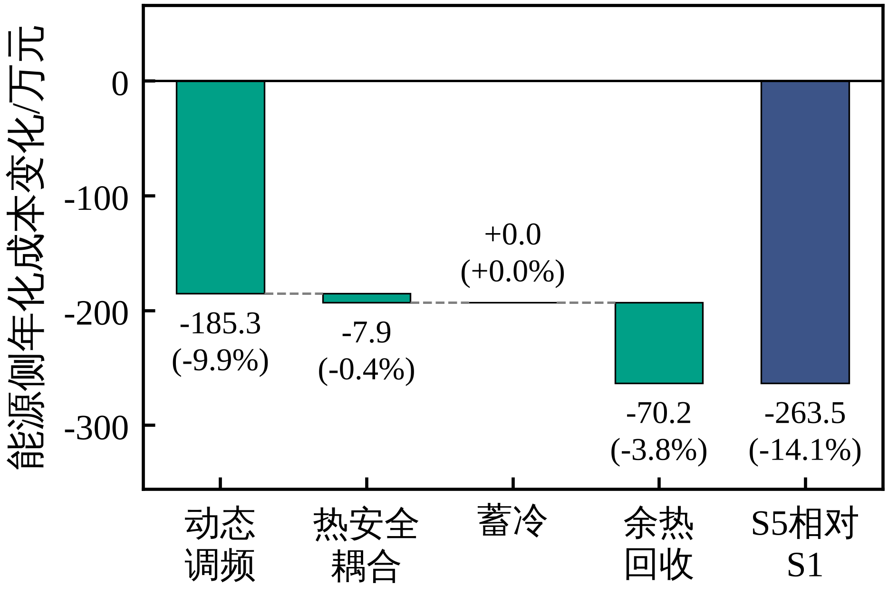

> **图4** S1到S5能源侧年化成本的逐级分解

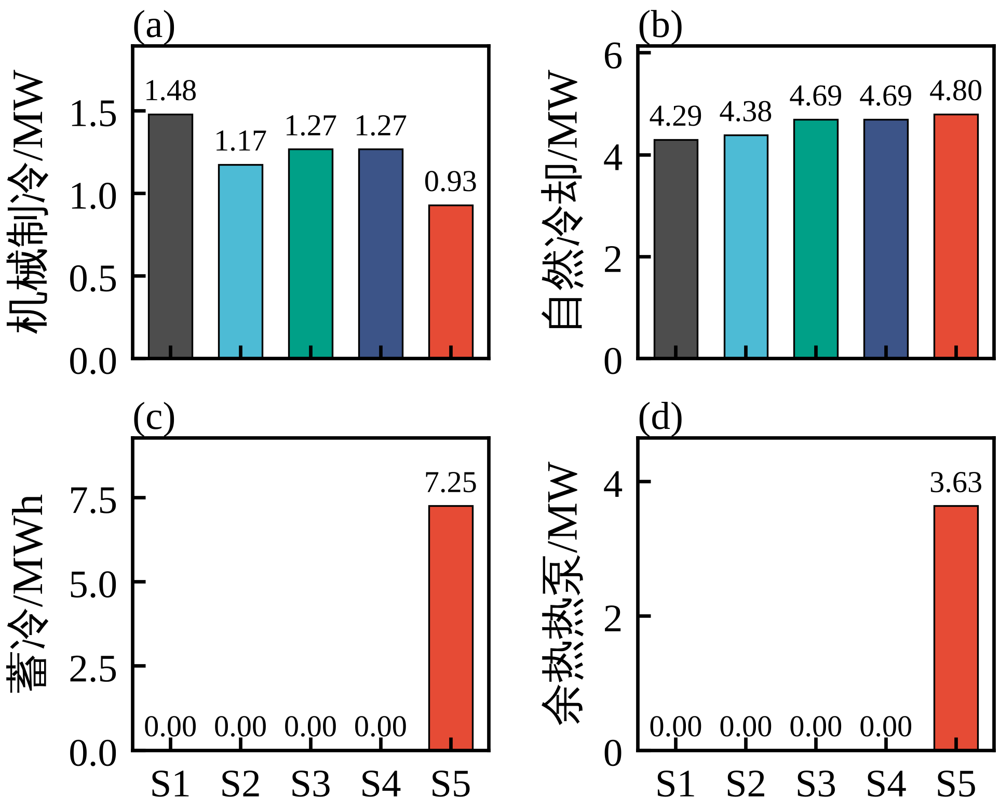

> **图5** S1–S5冷热源容量

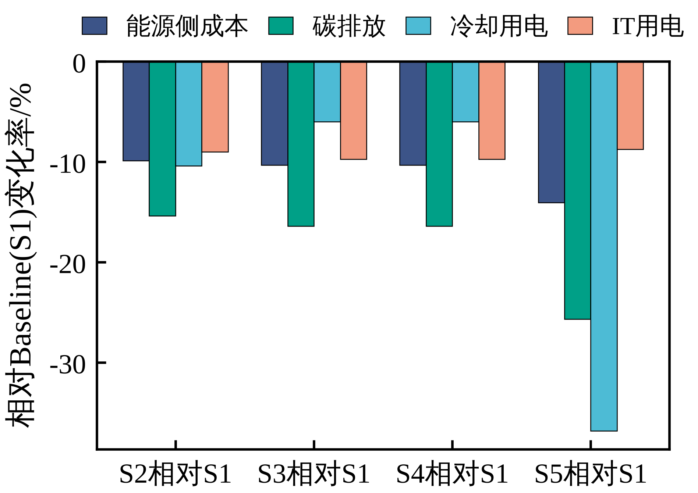

> **图6** S2–S5关键指标相对S1的变化率

### 5.3 忽略芯片热安全约束的后果

为检验热耦合建模的必要性，将S1、S2的规划容量代入S5完整模型（计及门控、温区漏电、气象冷源能效与热惯性，不配蓄冷与热泵），逐典型日求解运行问题，结果见表6。

**表6 S1、S2容量在完整模型中的复核结果**

| 指标 | S1 | S2 | S5 |
| --- | --- | --- | --- |
| 复核PUE | 1.210 | 1.209 | 1.194 |
| 按原规划方式运行时的热越限时长/h | 8760 | 3267 | 0 |
| 按原规划方式运行时的最大超温/K | 7.0 | 7.0 | 0 |
| 按热安全约束运行时的年实时缺额/(GPU·h) | 0 | 6660 | 0 |
| 实时任务满足率/% | 100 | 99.969 | 100 |
| 夏季典型日（6月27日）名义热越限时长/h | 24 | 7 | 0 |

S1全年以第1档在45 ℃温水下运行，芯片热点温度达92 ℃，比85 ℃上限高7 K，全年8760 h越限；S2通过调频降低了发热，但仍有3267 h使用了当前液冷温度下不安全的频率档位。按热安全约束重新运行时，S1的GPU有冗余，可以降档完成任务，未出现算力缺额，但需要更多冷源电耗，复核PUE升至1.210；S2的冷机容量更小，高温日无法同时满足热安全与算力需求，年实时缺额6660 GPU·h。S5的PUE（1.194）低于S1、S2的复核值，说明计及热耦合的规划在保证芯片安全的同时能效更高。

这一对比表明，以固定温度与固定能效确定冷源容量的传统规划，表面上PUE较低，实际上是以芯片超温为代价；本文模型把芯片热安全作为频率档位的约束，规划结果在运行中可行。

### 5.4 典型日运行分析

图7–图10给出S5在6月15日（夏季）与11月22日（采暖季）的运行结果，用于说明“频率—功耗—温度—冷却—余热”闭环的作用方式。

**（1）夏季日的档位与液冷温度（图7、图8）。** S1全天以第1档运行，液冷温度固定在45 ℃。S5全天未使用冷机，运行可分为三个阶段：

- 夜间谷电时段（2–6时）：气温19–22 ℃，全部GPU以第1档运行，液冷温度约40 ℃，处于第1档安全温区上限，由自然冷却散热。此时电价最低，以满频集中处理积压的可延期任务；0–6时第1档占比为67%。
- 上午与午间（7–14时）：GPU以第2档运行（安全温区上限45 ℃），液冷温度维持在39–42.5 ℃。6–9时气温较低，自然冷却在散热的同时为蓄冷罐充冷（0.93 MW）；10–13时气温升至27–32 ℃，自然冷却能力下降，蓄冷罐放冷补足。
- 午后与傍晚峰段（15–21时）：GPU降至第3、4档，单卡发热由0.70 kW降至0.41–0.49 kW，液冷温度由40.7 ℃（13时）升至47.9 ℃（18时）。液冷温度提高使自然冷却在33–34 ℃的气温下仍有逼近温差，系统无需冷机；17–21时为峰段电价，第4档进一步降低了IT用电。22时后电价回落，档位回升，液冷温度回落至44 ℃。

这一过程中，频率档位与液冷温度协同变化：低温时段以高频档满负荷运行，高温高价时段降档并提高运行温度，使自然冷却全天可用。液冷环路热惯性使温度在数小时内缓慢上升，吸收了午后的部分发热。按热安全约束，第3、4档在50–55 ℃温区仍然安全，系统正是利用了不同档位安全温区的差别。

**（2）可延期任务（图9）。** 可延期任务的处理量在谷时段（23–7时）占36%，而到达量在谷时段只占21%，任务由白天与傍晚向夜间转移。转移幅度受截止期D = 6 h限制：12–16时到达的任务最晚须在18–22时完成，无法推迟到谷时段。

**（3）采暖季日的液冷温度与余热回收（图10）。** S4不回收余热，冬季气温低，自然冷却充裕，液冷温度维持在30–39 ℃。S5中热泵全天按额定容量3.63 MW供热，从液冷环路取热3.0–3.1 MW，承担了绝大部分散热任务，自然冷却只在少数时段运行；液冷温度上移至40–45 ℃，46%的时段处于45 ℃温区下限。液冷温度升高提高了热泵源温，由式(18)，热泵COP由30–35 ℃温区的4.1提高到40–45 ℃温区的5.6，单位供热的热泵电耗下降约27%。为使液冷温度维持在40–45 ℃，GPU以第2–5档运行，17–19时峰段以第5档运行；20–21时工作GPU降至2777–3527卡，可延期任务推迟到22时以后处理。

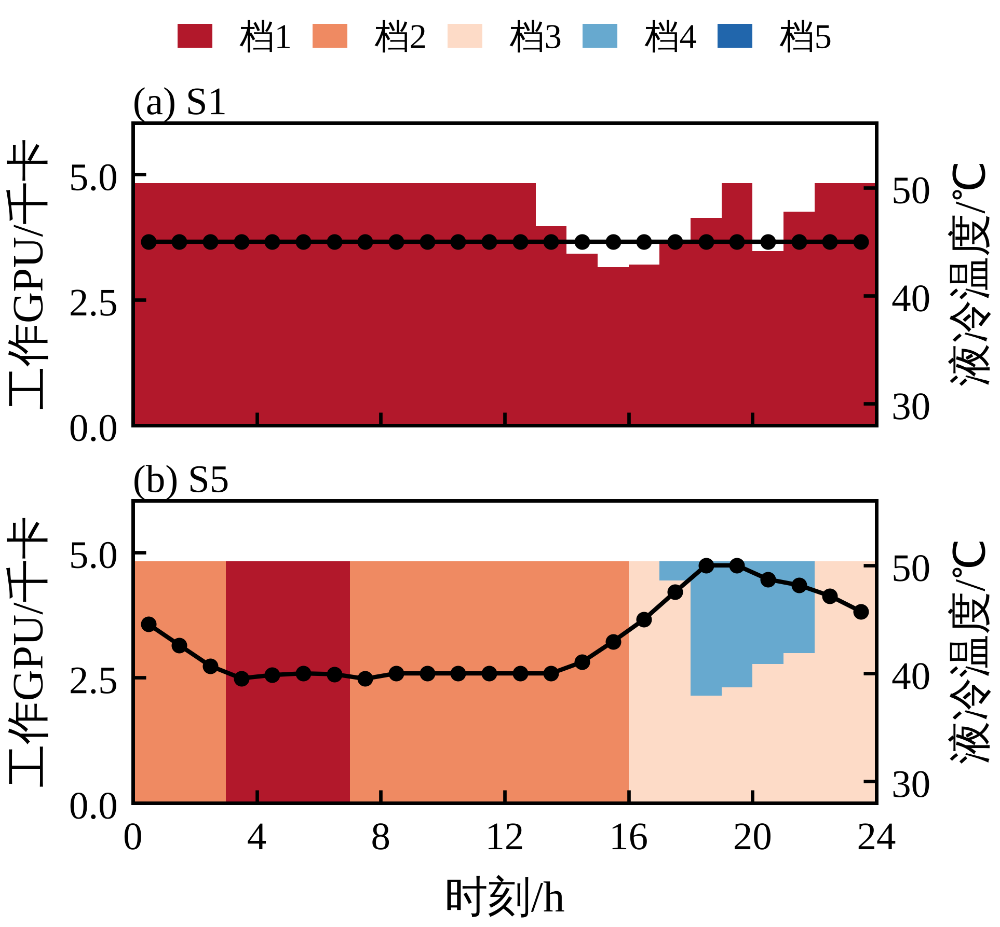

> **图7** 夏季典型日（6月15日）GPU档位与液冷温度

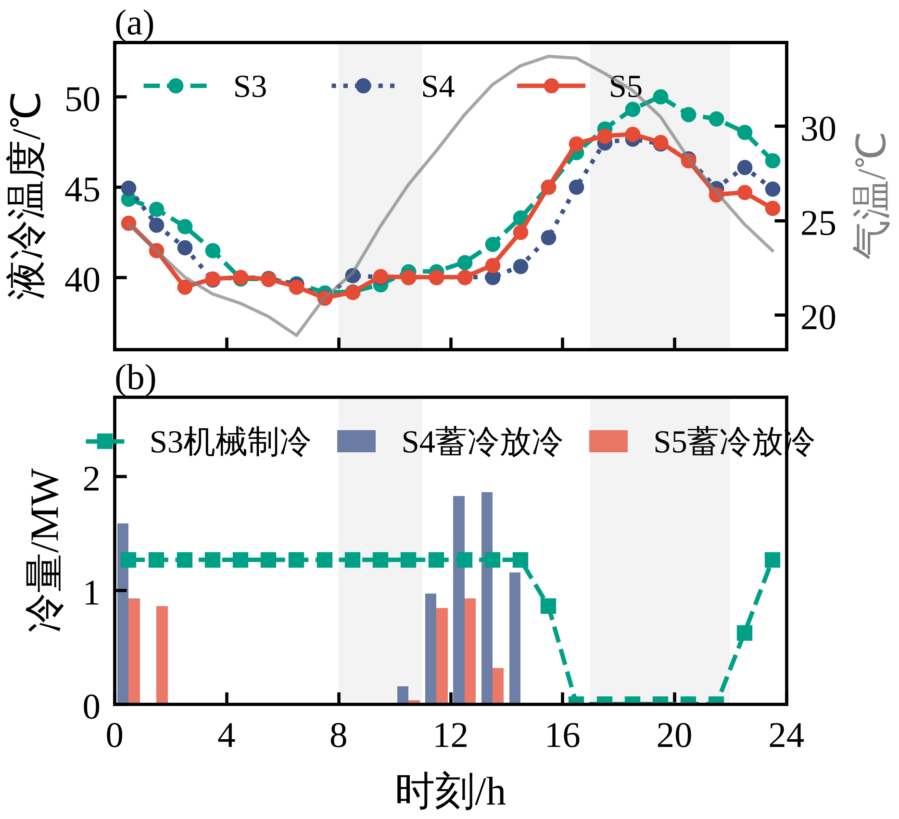

> **图8** 夏季典型日液冷温度与冷源出力

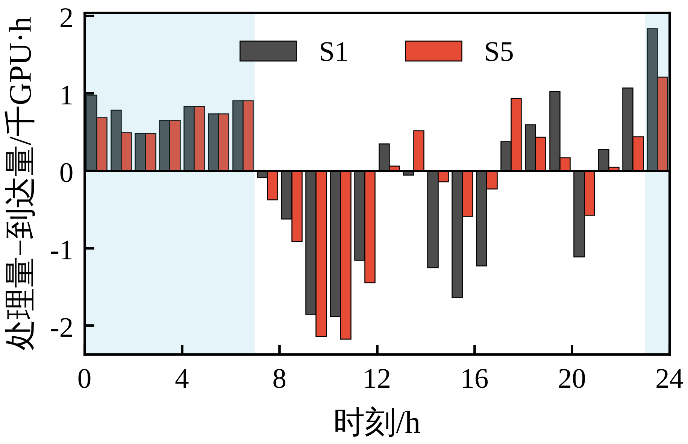

> **图9** 夏季典型日可延期任务处理量与到达量之差

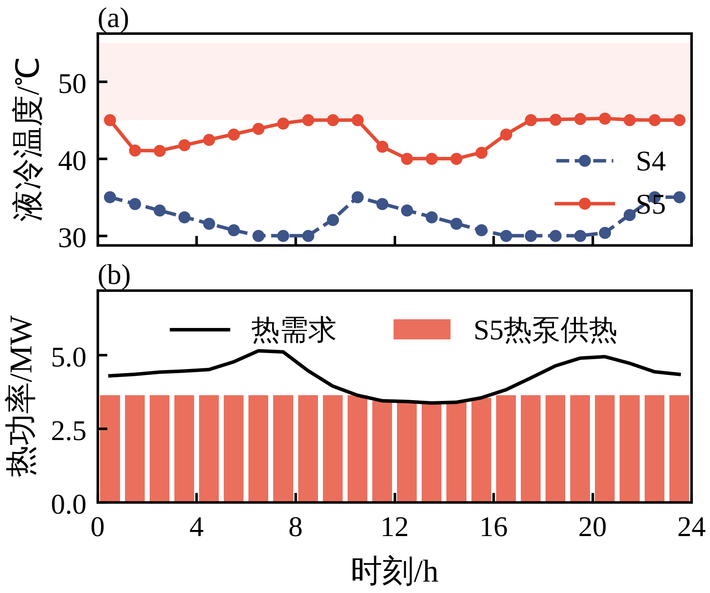

> **图10** 采暖季典型日（11月22日）液冷温度与余热回收

### 5.5 不确定性方法对比

**（1）基准典型日集合。** 以12个典型日构建经验分布时，S6（SP）、S5（DRO）、S7（RO）的能源侧年化成本依次为1564.1、1602.0、2498.3万元。SP与DRO的冷源结构相同（自然冷却6.76 MW、无冷机），DRO的蓄冷容量稍大（3.72 MWh对3.11 MWh）；RO以最不利单日为依据，保留了1.07 MW冷机。典型日把全年最高的算力需求日平均掉了：12个典型日的最大日算力需求比全年最大值低10.3%，基准集合不足以检验方法在极端情形下的表现。

**（2）加入极端日。** 在12个典型日之外加入4个极端日：7月24日（算力峰值日）、8月18日（日算力需求最大）、7月9日（日最高气温38.8 ℃）与7月10日（日平均气温最高），其经验概率各取1/365，K = 16，θ1 = 0.0912，θ∞ = 0.0111。三种方法的规划结果与365日样本外测试结果见表7与图11。

**表7 含极端日集合的SP、DRO、RO对比**

| 指标 | SP | DRO | RO |
| --- | --- | --- | --- |
| GPU/卡 | 4825 | 4825 | 5110 |
| 机械制冷/MW_th | 1.77 | 2.72 | 2.76 |
| 蓄冷/MWh_th | 26.1 | 2.5 | 7.9 |
| 余热热泵/MW_th | 4.30 | 4.08 | 3.02 |
| 年化投资（含GPU）/万元 | 33574.4 | 33556.7 | 35487.5 |
| 样本外期望年化总成本/万元 | 34961.7 | **34866.1** | 36277.9 |
| 样本外最高日运行成本/万元 | 126.8 | 113.4 | 18.8 |
| 实时缺额日概率/% | 3.8 | 3.8 | 0.5 |
| 年实时缺额时长/h | 26 | 23 | 2 |
| 实时任务满足率/% | 99.796 | 99.827 | 99.996 |

注：样本外测试以2023年365个历史日逐日运行（容量固定），期望总成本 = GPU年化投资 + 非GPU年化投资 + 365 × 日运行成本均值；日运行成本含购电、碳交易、售热收益与实时任务切除惩罚。

DRO的最恶劣分布把7月24日与8月18日两个算力极端日的概率由1/365提高到1.4%（约5倍），两个高温日的概率未被提高，表明本算例中的主要风险来自算力需求而非气温：高温造成的冷却缺口可以由冷机、降档与热惯性弥补，算力峰值则直接决定是否切除实时任务。据此，DRO与SP的GPU数量相同（均为式(33)的下限），但冷源结构不同：SP以大容量蓄冷（26.1 MWh）配合自然冷却，充分利用普通日夜间的低温低价；DRO以机械制冷为主（2.72 MW），可在任意时段提供冷量，使算力峰值日能以高频档运行。两者的投资基本相同（相差0.05%），RO则多配置285卡GPU，投资高5.8%。

样本外测试中，DRO的期望年化总成本最低，比SP低95.7万元（0.27%），比RO低1411.8万元（3.9%）；DRO的最高日运行成本比SP低10.5%，年实时缺额时长由26 h降至23 h。RO几乎消除了实时缺额（满足率99.996%），但多出的GPU年化投资约1900万元，远超其节省的切除惩罚。DRO与SP的缺额日概率相同（3.8%）：在算力冗余约束下，两者的实时缺额都只出现在少数算力峰值日，且只能通过增加GPU消除，冷源配置的差异对此影响有限。可见，DRO的优势主要体现在极端日的运行成本，而不是缺额频率。

**（3）求解性能。** 图12给出含极端日集合时DRO第二步C&CG的收敛过程。第1次迭代的上下界相对间隙为23.4%；第2次迭代加入最恶劣分布对应的场景后，间隙降至1.8%。RO的最恶劣分布集中在单个典型日，迭代3次，间隙由38.6%依次降至5.0%与3.1%。基准集合中各场景迭代1–3次，第二步用时31–92 min，最终间隙1.2%–2.4%，未达到0.1%，主要受开源求解器主问题MIP间隙的限制。与等价单层MILP（式(40)）相比，C&CG加邻域搜索得到的能源侧成本低1.3%–2.2%（S1、S2两者一致），说明分解算法在同一时限内得到了更好的可行解。嵌套热启动使后一场景以前一场景的解为初值，在本算例中S4的C&CG结果停留在S3的解（无蓄冷），按4.6节以同参数下其他方案为候选初值改进后，S4–S7的能源侧成本进一步降低0.1%–0.6%，表5为改进后的结果。

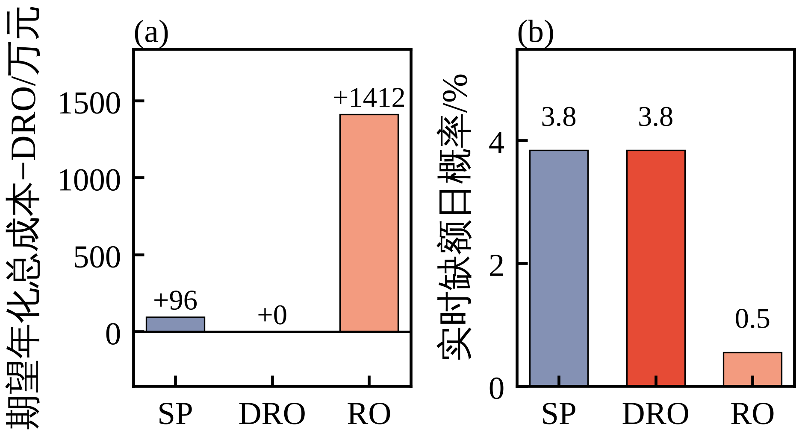

> **图11** 含极端日集合的SP、DRO、RO样本外测试

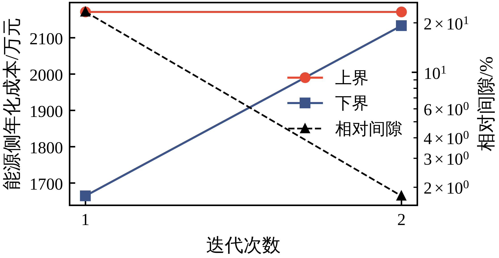

> **图12** 含极端日集合时DRO第二步C&CG收敛过程

### 5.6 灵敏度分析

灵敏度计算均针对S5，第二步以单层MILP加邻域搜索求解，时限1500 s；为使各点口径一致，基准点也按同一方法求解，能源侧年化成本为1607.2万元，比表5中经跨方案改进的S5结果高0.3%。各点单独求解的最终间隙为2.7%–3.1%，大于部分相邻点之间的成本差。对只改变模糊集半径的α1与M两组采用交叉评估：两组共10个容量方案对任一θ均可行，将全部方案在每个θ下按式(37)计算最恶劣期望运行成本，取年化总成本最低者作为该点结果。对固定方案，最恶劣期望成本随θ单调不减，交叉评估结果因而是各点最优值的单调上界估计。

**（1）置信水平α1与样本量M（图13）。** α1由0.2增至0.99，θ1由0.056增至0.128，能源侧年化成本由1605.0万元增至1614.7万元，增加0.6%，成本—θ1曲线的斜率由约296万元/单位θ1降至97万元/单位θ1，存在拐点，曲线呈凹形。凹形来自∞-范数约束：θ∞限制了单个典型日的概率增量（≤0.0107），θ1增大到一定程度后，最恶劣分布已把可调概率移到运行成本最高的几个典型日，继续增大θ1只能把概率分配给成本次高的典型日，边际成本递减。样本量的影响大得多：M由730降至90，θ1由0.032增至0.258，θ∞由0.0053增至0.043，能源侧成本由1588.5万元增至1721.9万元，增加8.4%。θ∞随M变化而与α1无关，这是两者影响相差一个数量级的主要原因。在全部10个θ取值下，基准方案（M = 365、α1 = 0.5）都是交叉评估中成本最低的方案，规划结果对置信水平与样本量的取值是稳健的。

**（2）算力冗余率（图14）。** r_N = 0与r_N = 0.1时，式(33)不起作用（1.1 × 4021 = 4424卡，低于无约束最优值4508卡），规划得到N = 4508卡；r_N = 0.2时N = 4825卡。与N = 4508卡相比，N = 4825卡时能源侧年化成本由1935.7万元降至1607.2万元（−17.0%），机械制冷容量由2.52 MW降至0.93 MW（−63%），PUE由1.208降至1.196，实时任务满足率由99.948%升至100%；但GPU年化投资增加2143万元，年化总成本增加5.6%。可见，算力冗余是调频与热管理发挥作用的前提：GPU全天满载时，系统只能以满频运行并依靠冷机维持液冷温度；留有冗余后，系统可以在高电价、高气温时段降档并提高运行温度。冗余的必要性来自算力服务可靠性与扩容需求，而非能源成本本身。

**（3）芯片温度上限（图16）。** 芯片温度上限由80 ℃放宽至87 ℃，机械制冷容量由2.44 MW降至0.70 MW（−71%），能源侧年化成本由1633.7万元降至1596.7万元（−2.3%）；90 ℃时的结果与87 ℃相同。芯片温度上限通过式(11)决定各档允许的最高温区：第1档允许的最高温区在80 ℃时为30–35 ℃，83 ℃与85 ℃时为35–40 ℃，87 ℃与90 ℃时为40–45 ℃。由于温区按5 ℃划分，门控随上限呈阶梯变化，87 ℃与90 ℃的门控矩阵相同，规划结果也相同。上限每放宽一个温区，满频运行所需的液冷温度提高5 ℃，自然冷却可承担的小时数增加，机械制冷需求明显下降。这表明芯片热安全约束是冷源容量的主要决定因素，规划中不能以固定的冷却温度代替。

**（4）热价（图17）。** 热价由0.10元/kWh_th增至0.30元/kWh_th，余热热泵容量依次为0.17、3.37、3.63、4.46、4.43 MW，能源侧年化成本由1674.4万元降至1473.3万元（−12.0%）。热泵容量在0.10–0.15元/kWh_th之间由0.17 MW跃升至3.37 MW，存在明显的切换阈值；热价高于0.25元/kWh_th后，热泵容量受采暖季热负荷与可回收余热的限制不再增加。

**（5）液冷环路热惯性（图15）。** 对S4改变液冷环路等效热容C_w（满载无冷却时每小时温升6、8、12、24 K对应的取值），结果见表8。

**表8 液冷环路等效热容对S4规划结果的影响**

| C_w/(kWh/K) | 1150 | 862.5 | 575 | 287.5 |
| --- | --- | --- | --- | --- |
| 满载每小时温升/K | 6 | 8 | 12 | 24 |
| 蓄冷/MWh_th | 7.43 | 6.92 | 6.82 | 13.62 |
| 机械制冷/MW_th | 0 | 0 | 0 | 0 |
| 自然冷却/MW_th | 6.76 | 6.67 | 6.63 | 6.36 |
| 能源侧年化成本/万元 | 1668.0 | 1669.2 | 1670.1 | 1669.4 |

在C_w = 575–1150 kWh/K的范围内，蓄冷容量稳定在6.8–7.4 MWh，能源侧成本随C_w减小单调上升，但变化不超过0.13%，小于求解间隙；C_w降至基准值的1/4时，蓄冷容量增至13.6 MWh，约为基准的2倍。可见在常见的液冷系统热容范围内，环路热惯性在规划层面的作用有限，冷侧时移主要由蓄冷罐承担；只有热容很小时，热惯性的缓冲作用才需要由更大的蓄冷罐补偿。热惯性的作用主要体现在运行层面：5.4节中，液冷温度在午后数小时内由40 ℃逐渐升至48 ℃，使降档与升温能够平滑进行，S3中冷机也得以在傍晚峰段停机。

**（6）气候区对比（图18）。** 在中卫之外选取贵州贵安（东数西算贵州枢纽）与广东韶关（粤港澳大湾区枢纽）两地，气象取NASA POWER 2023年逐时数据；两地无集中供热，热负荷只计0.3 MW_th生活热水；算力负荷、电价、设备参数与算力冗余率与中卫相同，各自聚类得到12个典型日后按同一方法求解S1、S3–S5，并做同样的跨方案改进。结果见表9。

**表9 三地气候特征与规划结果**

| 指标 | 中卫 | 贵安 | 韶关 |
| --- | --- | --- | --- |
| 年平均气温/℃ | 11.7 | 15.9 | 20.0 |
| 年最高气温/℃ | 38.8 | 33.9 | 34.6 |
| 气温>30 ℃小时数/h | 606 | 54 | 655 |
| 光伏年等效利用小时/h | 1546 | 1096 | 1116 |
| S3机械制冷/MW_th | 1.27 | 0.04 | 0 |
| S5自然冷却/MW_th | 6.76 | 5.58 | 6.49 |
| S5机械制冷/MW_th | 0 | 0.04 | 0.02 |
| S5蓄冷/MWh_th | 3.72 | 6.72 | 12.01 |
| S5余热热泵/MW_th | 3.63 | 0.20 | 0.20 |
| S5名义PUE | 1.194 | 1.204 | 1.205 |
| S5年余热回收/GWh | 12.57 | 1.19 | 1.22 |
| S5能源侧年化成本/万元 | 1602.0 | 2115.4 | 2110.1 |
| S5较S1能源侧成本降低/% | 14.4 | 10.6 | 10.8 |

三地中，所提方法相对传统规划的能源侧成本降幅为10.6%–14.4%，调频与热耦合的效益在不同气候下都存在；中卫降幅最大，主要因为采暖季余热回收量大。气候对冷源结构的影响有两点值得注意。其一，是否需要冷机取决于年最高气温，而不是年平均气温或高温时数：计入热安全门控后，系统可以在午后降档并把液冷温度提高到45–50 ℃，自然冷却在约40 ℃的气温下仍可运行；中卫年最高气温38.8 ℃，不配蓄冷时（S3）需要1.27 MW冷机，贵安与韶关的最高气温低于35 ℃，基本不需要冷机。其二，高温时数决定蓄冷规模：韶关气温高于30 ℃的时间最长，自然冷却能力在午后持续偏低，蓄冷罐容量最大（12.01 MWh），以夜间充冷、午后放冷的方式替代冷机。PUE以韶关最高、中卫最低，余热回收以中卫最大，与执行方案的预期一致；机械制冷容量则因高温运行而在三地都很小，与“韶关冷机容量最大”的预期不同。

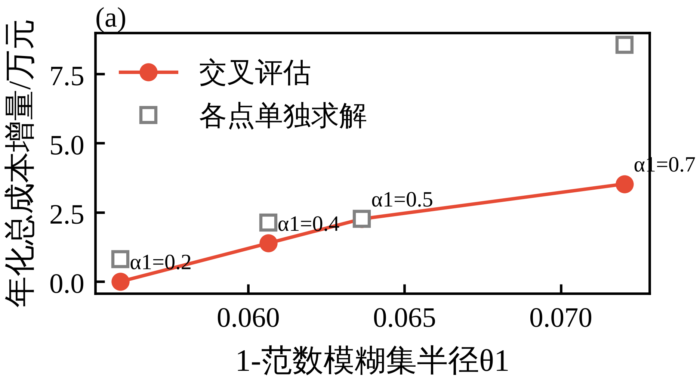

> **图13** 置信水平α1与样本量M对年化总成本的影响

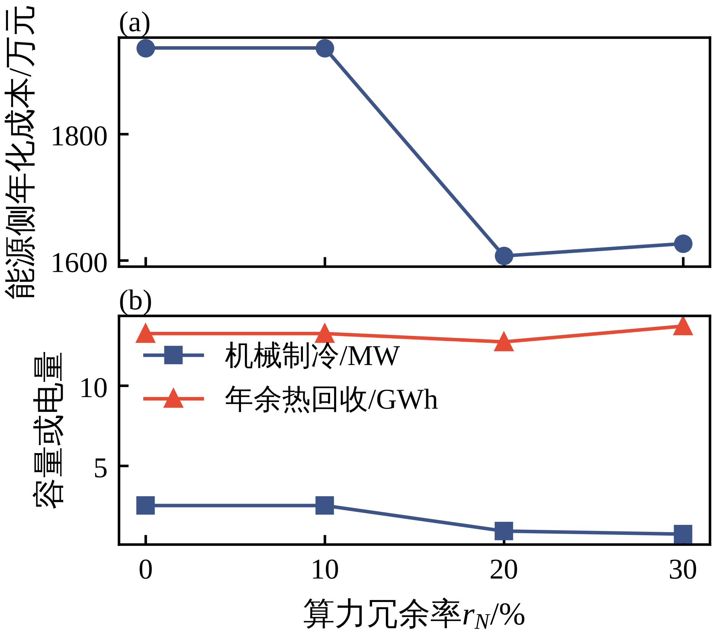

> **图14** 算力冗余率的影响

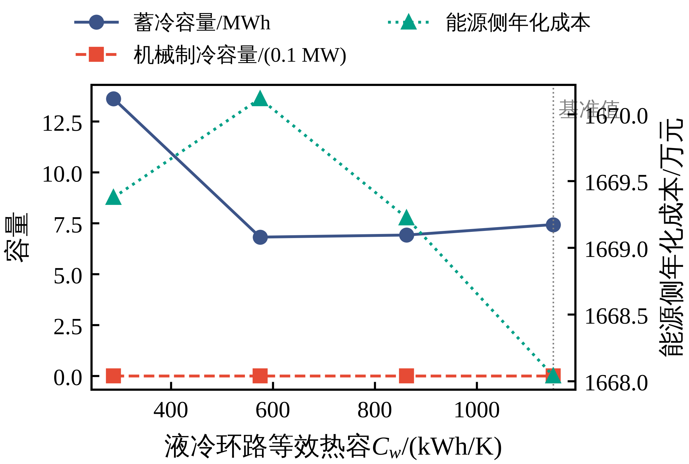

> **图15** 液冷环路等效热容对蓄冷与机械制冷容量的影响

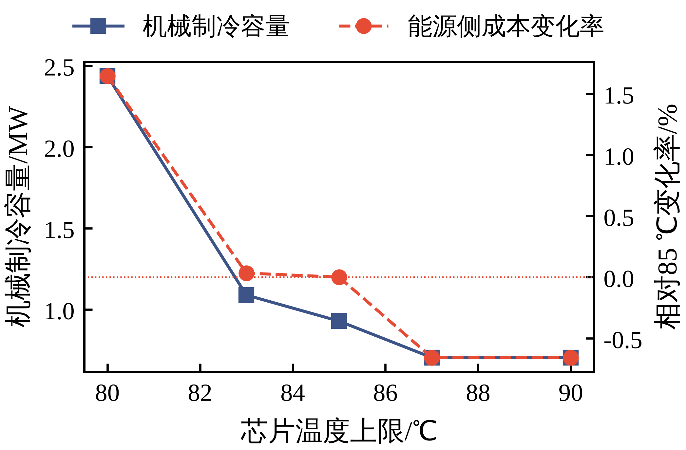

> **图16** 芯片温度上限的影响

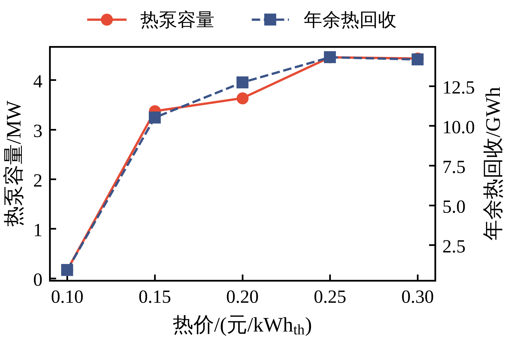

> **图17** 热价对余热热泵容量与余热回收量的影响

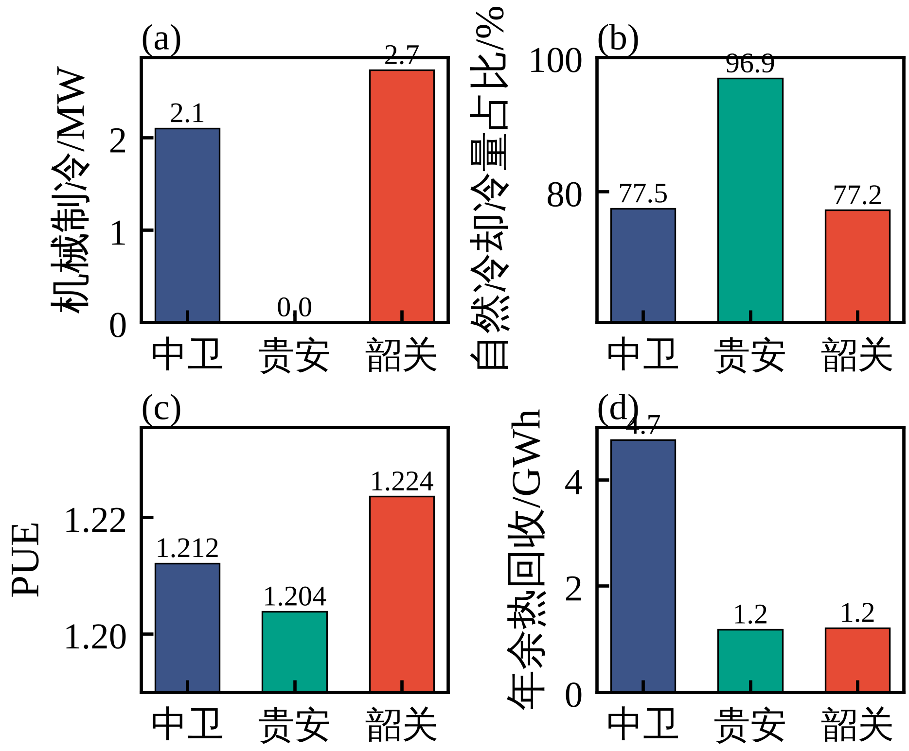

> **图18** 三地气候区规划结果对比

## 6 结论

本文以GPU频率档位与液冷环路温度为纽带，建立了AI算力园区算—电—热协同的两阶段分布鲁棒容量规划模型，并以宁夏中卫规划园区为算例进行了分析，主要结论如下：

1）动态调频与余热回收是降低园区能源成本的两个主要来源。与不计调频与热耦合的传统规划相比，本文方法使能源侧年化成本降低14.4%，碳排放降低26.2%，年回收余热12.57 GWh。其中动态调频贡献约69%的成本降幅，来自低频档单位工作量能耗的降低；余热回收贡献约25%，并通过热泵从液冷环路取热分担了35%的冷量。

2）芯片热安全约束是冷源规划不可忽略的条件。按45 ℃温水设计、不计频率档位热安全的传统规划，在完整模型中全年8760 h芯片超温；计入门控后，其冷源容量不足，年实时算力缺额6660 GPU·h。芯片温度上限由80 ℃放宽至87 ℃，机械制冷容量降低71%，门控随温区呈阶梯变化。

3）频率档位与液冷温度的协同使系统可以取消冷机。规划方案在夏季夜间低温低价时段以满频运行，午后高温与傍晚高价时段降档并把液冷温度提高到45–48 ℃，使自然冷却在34 ℃气温下仍可运行，配合蓄冷罐承担午间峰值，机械制冷容量由1.27 MW降至0；采暖季则把液冷温度提高约10 ℃，热泵COP由4.1提高到5.6。在常见的环路热容范围内，热惯性在规划层面的作用有限，冷侧时移主要由蓄冷罐承担。

4）上述效益以一定的算力冗余为前提。算力冗余率由0提高到0.2时，能源侧年化成本降低17.0%，机械制冷容量降低63%；冗余率继续提高到0.3，空闲GPU的基础功耗使能源侧成本回升1.2%。计入GPU投资后，冗余使年化总成本上升，其依据是算力服务的可靠性。

5）分布鲁棒方法在含极端日的样本外测试中期望年化总成本最低，比随机规划低0.27%、比鲁棒优化低3.9%，最高日运行成本比随机规划低10.5%；其最恶劣分布提高了算力峰值日而非高温日的权重，以机械制冷为主的冷源结构应对算力峰值。两者的实时缺额日概率相同，进一步降低缺额频率需要增加GPU。模型保守度主要由样本量决定：样本量由730降至90，成本增加8.4%，而置信水平α1在0.2–0.99范围内只影响0.6%。

6）热价是余热热泵配置的关键参数，热泵容量在0.10–0.15元/kWh_th之间出现切换。气候主要影响冷源结构而不影响方法的效益：三地能源侧成本降幅为10.6%–14.4%；计入热安全门控后，是否需要冷机取决于年最高气温，高温时数多的韶关以最大的蓄冷容量替代冷机，有集中供热需求的中卫余热回收量最大、PUE最低。

本文的局限包括：采用开源求解器HiGHS，第二步最终相对间隙为1.2%–2.4%，未达到0.1%；峰值IT功率在各场景相同，本文电价未计需量电费，调频没有降低峰值功率的经济动力；可延期任务的截止期限制了负荷向谷时段的转移，谷时段处理占比为36%。后续可引入两部制电价与更长截止期的训练任务，并研究GPU分批投建的多阶段规划。

## 参考文献

[1] International Energy Agency. Energy and AI[R]. Paris: IEA, 2025.

[2] Wierman A, Liu Z, Liu I, et al. Opportunities and challenges for data center demand response[C]//2014 International Green Computing Conference (IGCC). Dallas: IEEE, 2014. DOI: 10.1109/IGCC.2014.7039172.

[3] Riepin I, Brown T, Zavala V M. Spatio-temporal load shifting for truly clean computing[J]. Advances in Applied Energy, 2025, 17: 100202.

[4] Colangelo P, et al. Turning AI data centers into grid-interactive assets: results from a field demonstration in Phoenix, Arizona[EB/OL]. arXiv: 2507.00909, 2025.

[5] Wang J, Deng H, Liu Y, et al. Coordinated optimal scheduling of integrated energy system for data center based on computing load shifting[J]. Energy, 2023, 267: 126585.

[6] Li W, Qian T, Zhang Y, et al. Distributionally robust chance-constrained planning for regional integrated electricity–heat systems with data centers considering wind power uncertainty[J]. Applied Energy, 2023, 336: 120787.

[7] Ma B, Li X, Tan Q, et al. Multi-objective multi-stage distributionally robust chance-constrained low-carbon planning model for a novel integrated multi-energy microgrids incorporating data center considering real-time workload response and multiple uncertainties[J]. Energy, 2025, 332.

[8] Tang Z, Wang Y, Wang Q, et al. The impact of GPU DVFS on the energy and performance of deep learning: an empirical study[C]//Proceedings of the 10th ACM International Conference on Future Energy Systems (e-Energy). Phoenix: ACM, 2019: 315-325.

[9] Zapater M, Tuncer O, Ayala J L, et al. Leakage-aware cooling management for improving server energy efficiency[J]. IEEE Transactions on Parallel and Distributed Systems, 2015, 26(10): 2764-2777.

[10] Pakbaznia E, Pedram M. Minimizing data center cooling and server power costs[C]//Proceedings of the 2009 International Symposium on Low Power Electronics and Design (ISLPED). San Francisco: ACM, 2009: 145-150.

[11] Zimmermann S, Meijer I, Tiwari M K, et al. Aquasar: a hot water cooled data center with direct energy reuse[J]. Energy, 2012, 43(1): 237-245.

[12] Luo Y, Andresen J, Clarke H, et al. A decision support system for waste heat recovery and energy efficiency improvement in data centres[J]. Applied Energy, 2019, 250: 1217-1224.

[13] Zhao C, Guan Y. Data-driven stochastic unit commitment for integrating wind generation[J]. IEEE Transactions on Power Systems, 2016, 31(4): 2587-2596.

[14] Zeng B, Zhao L. Solving two-stage robust optimization problems using a column-and-constraint generation method[J]. Operations Research Letters, 2013, 41(5): 457-461.

[15] Guo C, Luo F, Cai Z, et al. Integrated energy systems of data centers and smart grids: state-of-the-art and future opportunities[J]. Applied Energy, 2021, 301.

[16] Ravi A, Löffler M, Pina A. From servers to services: modeling data centers as heat-active urban energy prosumers[J]. Applied Energy, 2026, 402.

## 附录 参数表

**附录表A1 GPU频率档位参数**（单卡服务器基础功率0.45 kW，参考温度40 ℃时漏电0.14 kW，漏电温度系数0.02 /K）

| 档位 | 频率比 | 吞吐比 | 动态功率/kW | 芯片发热/kW | 安全液冷温区 | 可用任务 |
| --- | --- | --- | --- | --- | --- | --- |
| 1 | 1.0 | 1.00 | 0.560 | 0.700 | 30–40 ℃ | 实时、可延期 |
| 2 | 0.9 | 0.94 | 0.448 | 0.588 | 30–45 ℃ | 实时、可延期 |
| 3 | 0.8 | 0.87 | 0.350 | 0.490 | 30–55 ℃ | 实时、可延期 |
| 4 | 0.7 | 0.78 | 0.266 | 0.406 | 30–55 ℃ | 可延期 |
| 5 | 0.6 | 0.68 | 0.196 | 0.336 | 30–55 ℃ | 可延期 |

**附录表A2 热管理参数**

| 参数 | 取值 |
| --- | --- |
| 芯片温度上限、冷却液—热点热阻 | 85 ℃，60 K/kW |
| 液冷温区 | 30–35、35–40、40–45、45–50、50–55 ℃ |
| 液冷份额β、等效热容C_w | 0.75，1150 kWh/K |
| 自然冷却逼近温差/设计温差、风机电耗系数 | 5 K / 15 K，0.04 |
| 冷机COP（25 ℃、35 ℃基准） | 6.0，c1 = 0.12 /K，c2 = 0.1 /K，截断[3, 9] |
| 余热热泵 | 供热70 ℃，η_c = 0.45，COP上限7 |
| 蓄冷罐 | 自损0.5%/h，效率0.97，最短充放时间4 h |
| 辅助电耗 | δ_e = 0.03，a_circ = 0.02，a_air = 0.25，P0 = 300 kW |

**附录表A3 设备经济参数**（折现率8%）

| 设备 | 单价 | 寿命/年 | 年运维率 | 安装上限 | 年化费用 |
| --- | --- | --- | --- | --- | --- |
| GPU（元/卡） | 250000 | 5 | 0.02 | 8000 | 67614.1 |
| 光伏（元/kW） | 3000 | 25 | 0.01 | 15000 | 311.0 |
| 储能能量（元/kWh） | 600 | 12 | 0.015 | 80000 | 88.6 |
| 储能功率（元/kW） | 300 | 12 | 0.015 | 20000 | 44.3 |
| 自然冷却（元/kW_th） | 800 | 20 | 0.02 | 20000 | 97.5 |
| 机械制冷（元/kW_th） | 1200 | 20 | 0.02 | 10000 | 146.2 |
| 蓄冷罐（元/kWh_th） | 60 | 25 | 0.01 | 60000 | 6.2 |
| 余热热泵（元/kW_th） | 2000 | 20 | 0.02 | 6000 | 243.7 |

**附录表A4 价格、碳交易与惩罚参数**

| 参数 | 取值 |
| --- | --- |
| 分时电价（峰/平/谷） | 1.05/0.62/0.28 元/kWh；峰段8–11时、17–22时，谷段23–7时 |
| 并网容量 | 12 MW，不向电网反送电 |
| 热价 | 0.2 元/kWh_th |
| 电网排放因子、替代供热排放因子 | 0.57 kg/kWh，0.22 kg/kWh_th |
| 碳配额 | 0.6 kg/(GPU·h) |
| 阶梯碳价 | 基准80元/t，区间长度20 t，每级增幅25%，共5级 |
| 实时任务切除惩罚、可延期任务超期惩罚 | 150 元/(GPU·h)，3 元/(GPU·h) |
| 弃光惩罚、储能损耗成本 | 0.1 元/kWh，0.02 元/kWh |
| 算力冗余率、截止期 | r_N = 0.2，D = 6 h |
